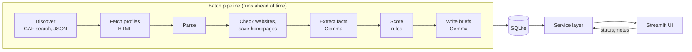

# Design

Ridgeline Leads is a sales-intelligence tool for reps at a roofing distributor. A batch pipeline researches and ranks every GAF-certified residential roofer near the branch ahead of time, and has an AI write a brief for the top leads. The app shows reps who to call first, why, and what to say, and records how each call went.

## 1. The problem

Sales reps at a roofing distributor need to know which contractors to approach, why, and what to say. Here a lead is a GAF-certified residential roofing contractor within 25 miles of ZIP 10013, and GAF's directory lists 423 of them.

Before designing anything, I spoke with distributors about how they sell. Their business is mainly inbound, so the tool adds what they rarely do: outbound prospecting, with a plan for each call.

The first call won't close a sale. Contractors buy materials job by job and split purchases across suppliers, so the realistic first win is a place on a contractor's shortlist and a trial order on an upcoming job. The app tracks that ladder for each lead: contacted, considering us (asked for pricing or a quote), and first order.

I assumed a new distributor entering the market, so every contractor is a prospect, with one rep and residential work only. Rep data carries a rep ID from the start, so adding reps means adding login, not reshaping data. This is sales intelligence, not a CRM: it finds and researches prospects and hands reps a plan, and the relationship itself belongs in the distributor's CRM.

## 2. What a rep gets

- **Who to call first:** the app opens on the top 10 of each preset (Balanced, Big accounts and Quick wins), 19 leads in all, one at a time, with the signals behind each score. Every other contractor is a click away, ranked by the preset the rep picks.
- **What to say:** for each preset's top 10, a brief with why this contractor, an opener, follow-ups, and questions about upcoming jobs.
- **What we know:** facts from the contractor's GAF profile and website, each with the quote it came from: the ones a brief cites, or all of them for a lead without a brief.
- **Where it stands:** a status on the ladder, notes, and a call sheet that logs a call in one step.

Where data is missing, the app says so instead of guessing. The clearest time saving is in choosing who to call: 423 contractors become a ranked list with reasons, instead of profiles and websites opened one by one. The briefs help least where little is known. I haven't measured either with reps; in production I'd track the time from opening a lead to logging a call, and the win rate by score band.

## 3. Architecture

A batch pipeline does the expensive work ahead of time: finding contractors, reading their pages, extracting facts with AI, scoring, and writing briefs. The app reads those results and records what reps do. AI cost grows with the number of contractors, not page views, and a rep never waits on a model.

Every table has one kind of writer. The pipeline writes generated data, and reps write only their statuses and notes, through a service layer that is the UI's only way to the data. A pipeline refresh can't erase a rep's work, and AI output stays separate from human input. The code follows the same flow, one folder per part, so in production each stage can become a queue worker and the services can sit behind an API without a rewrite.

## 4. Key decisions

### Getting the data

GAF's locator page has no contractor data in its HTML. Its results come from a search API that the page calls with a public key. I weighed three ways in:

- **Browser automation:** works on any page, but it's slow and breaks when the layout changes.
- **Replaying the search request (chosen):** structured JSON with ratings, tiers and distance, and five requests return all 423 contractors.
- **Crawling GAF's sitemap:** every contractor nationally, but with no distance filter. It's my fallback, and the better path for national coverage.

The details the AI needs most, like the About text, website and founding year, exist only on each profile page, so the pipeline fetches and parses those too. The client is deliberately polite: about one request a second, a descriptive User-Agent, and it stops if GAF starts refusing requests. robots.txt allows these pages, but GAF's terms restrict commercial use, so production would need a data agreement with GAF.

### Storing it

I chose SQLite through SQLAlchemy, with Alembic migrations from day one, over Postgres in Docker. Postgres is what production needs, but SQLite lets a reviewer run everything with no setup, and the code stays portable: standard types, and the one operation the two databases spell differently, the upsert, behind one function. SQLite allows one writer at a time, which is fine for one rep and is the main reason production moves to Postgres.

Data moves through layers, each rebuildable from the one below:

- **Raw responses**, saved before parsing, so a parser fix never needs a refetch and every field traces back to its source.
- **Contractors**, one row each, keyed on GAF's contractor ID.
- **Facts, scores and briefs:** every fact keeps its quote, scores are stored as components, and every brief records the model and prompt that wrote it.
- **Rep data**, append-only: every status change or note is a new row, so nothing a rep saves is ever overwritten.

Missing values stay null rather than zero. On the first page of results, 92 of 100 contractors showed a 0.0 rating with no reviews; stored as zeros, they'd look terrible to any rule. Raw pages are 118 of the database's 120 MB, so in production they'd move to object storage. The repo ships a 5.6 MB seed of the processed data instead, so a fresh clone runs the app and the tests with no keys.

### Running the pipeline, and scale

Each stage, from discovery to briefs, is a separate function that is safe to rerun and skips finished work, so a crashed run resumes rather than restarts. I considered a task queue or an orchestrator like Airflow, but for one territory they'd add infrastructure with nothing to show for it, and each stage can become a queue worker later. Every outside response is saved before it's parsed, a contractor whose AI call keeps failing is recorded and skipped, and every AI call is logged.

Scale has two axes:

- **More reps means more reads, not more pipeline runs.** Results are precomputed, and a rep's preset is applied as arithmetic when the list loads. Writes stay small: 1,000 reps at 50 actions a day is under two writes a second. A page spends about 80 ms in the service layer today; at hundreds of reps, I'd cache each scoring run's rankings.
- **More territories means more discovery.** Overlapping searches return the same contractors, deduplicated by GAF's ID. Nationally, one sitemap crawl assigned to territories by location beats thousands of overlapping searches.

### Ranking leads

Rules rank the leads, and the AI never scores. A rule-based score gives the same answer every run, can be tested and defended line by line, and changes with a config edit.

Each lead gets four components from 0 to 100, combined by a weighted sum:

- **Value**, the business it could bring: review count, certification tier, and other trades.
- **Winnability**, how open it is to a new supplier: newer businesses and mid-tier contractors score higher, because every distributor already chases the top tier.
- **Stability:** the rating, once there are at least 5 reviews.
- **Distance**, as a cost.

I considered ranking by tier or by value alone, but that sends every distributor to the same top contractors, and as a new entrant I'd rather find the accounts nobody has locked up yet. Multiplying value by the odds of winning was the other option; a weighted sum is easier to explain and tune. Three presets, Balanced, Big accounts and Quick wins, let a rep tilt the weights without touching numbers.

The score is less certain than it looks, so the app is open about it. A missing signal scores a neutral 50, and about 30% of the signals are missing, so each score shows its signals with the guesses greyed out, and the app never shows a rank next to a score. Years in business come only from GAF's profile, not from the contractor's own site, because a year a contractor writes about itself is easier to inflate. The weights are hypotheses until there's outcome data, and I hand-checked each preset's top 10 against its strategy.

The score also can't say whether a contractor will pay its bills. Research on small businesses finds the best predictor of that is how a business has paid its other suppliers, and that history isn't public. So credit stays a separate decision, made when an account opens, with credit-bureau data and the distributor's own records.

### Using AI

The AI does two jobs, and code checks both:

- **Reading.** For each contractor with About text or a saved homepage, 128 of the 423, the model fills a fixed form: founding year, services, other trades, building types, service areas and owners. Every item must quote the text, and code drops any item whose quote isn't there. That gave 2,482 facts for 125 contractors. An answer key for 10 contractors is ready for hand-checking, but I haven't scored against it yet.
- **Writing.** For each preset's top 10, 19 contractors in all, it writes a brief: why this contractor, an opener, follow-ups and questions. A brief may cite only the facts it was given and the selling points that rules matched to the lead, and it never mentions a score. A rep reviews each brief before using it.

Rules, not the AI, pick the selling points. Credit terms, for example, go only to contractors with a good rating and are never the opener, because contractors who can't settle their balances shop for credit.

I chose Gemma 4 31B on the Gemini API's free tier. It's free at this volume and open-weight, so a distributor could host it themselves. A paid model wasn't needed at this volume, and a local one would make every reviewer run a 31B model. The free tier failed often, so every call goes through one module that validates the output, caches it, paces requests and retries, and switching models is a config change.

### The UI

I chose Streamlit over React, NiceGUI and HTMX. Python is my strongest language, and I can change Streamlit quickly and by hand. React would look more polished, but I couldn't change it live as confidently.

The principle is that a rep should know the next step within seconds of opening a lead. A review at laptop size shaped the layout:

- The app opens on Top leads: one lead at a time from every preset's top 10, with its brief, its score's reasons, and its notes side by side, so nothing hides behind a tab. Previous and Next step through them: the leads more presets pick come first, then the ones placed highest in a preset, so the rep has no preset to choose.
- Top leads shows only leads with a brief, so every lead on it comes with a plan.
- Tags name only exceptions: the presets whose top 10 a lead is in, a tier above Certified, or New business.
- All leads, the second page, keeps every contractor: the table, ranked by the preset the rep picks, on the left and the selected lead on the right, in tabs.
- On All leads, a filter counts leads by stage, so the list shrinks as the rep works.
- Search by name or phone doubles as a lookup when a contractor calls in.
- A call sheet logs the outcome and opens the next lead.
- Each page fits one laptop screen with no page scroll.

## 5. How I built it

I built the system in nine slices with Claude Code, checking each against its brief and the tests before starting the next. The 186 tests run offline against saved real pages, so a change to a parser or a rule is checked without touching the network. Each brief placed the work in the whole system: the files it touched, the rules every slice keeps, and the checks that prove it's done. Those rules and a map of the code are committed as AGENTS.md, so another developer, or their own agent, can pick up the codebase quickly. The README's table shows what can be customized, where, and what to rerun. I kept a decision log throughout, and this document condenses it.

## 6. What I'd do with another 8 hours

1. **Find decision-makers.** Only 13 of the 125 contractors with facts name an owner. Business filings and license records are the next sources.
2. **Split the score into two questions, plus a gate.** "Is this account worth having?" and "Is it open to us now?" would show side by side instead of blended into one number. A risk gate would draw on free public records, NYC's contractor licenses and complaints and New Jersey's contractor registrations, and a failed gate would mean cash-only terms, not a deleted lead.
3. **Add "why now" signals** by comparing runs: new contractors, tier upgrades, review jumps, and contractors leaving GAF's directory. Research on distributors suggests that when contractors do switch suppliers, it's mostly because their current one failed them, not because of a better pitch, so follow-ups should fire on changes like these rather than on fixed dates.
4. **Rewrite a brief when a rep adds a note,** so what reps learn on calls feeds the brief. I cut it because each rewrite takes about 37 seconds on an unreliable free tier.
5. **Grow the evals:** a bigger answer key, checks on brief quality, and a rerun on every prompt or model change.
6. **Add an API and login, and test against Postgres:** FastAPI over the service layer with a territory per rep, and the tests running against Postgres in CI to prove the migration path.

## 7. Path to production

This MVP works from public data and covers the first step: finding accounts worth winning. The signals that matter most after that live in the distributor's own systems. Its ERP holds order and payment history, its CRM holds the relationship, and its inbox holds the conversations. Production would connect them:

- **Act, not just inform:** an agent per account watches its signals, drafts the next touch for the rep to approve, and logs the outcome back to the CRM.
- **Existing customers too:** a contractor that buys only shingles from us is a cross-sell lead, so share of wallet becomes a signal.
- **Learn from the right outcome:** each account's 12-month margin, net of the cost to serve it and any bad debt. Learning from first orders alone would reward the contractors who are shopping for credit.
- **Underneath:** a data agreement with GAF, national discovery from the sitemap, Postgres with PostGIS, object storage for raw pages, scheduled queue workers, and a paid or self-hosted model.
