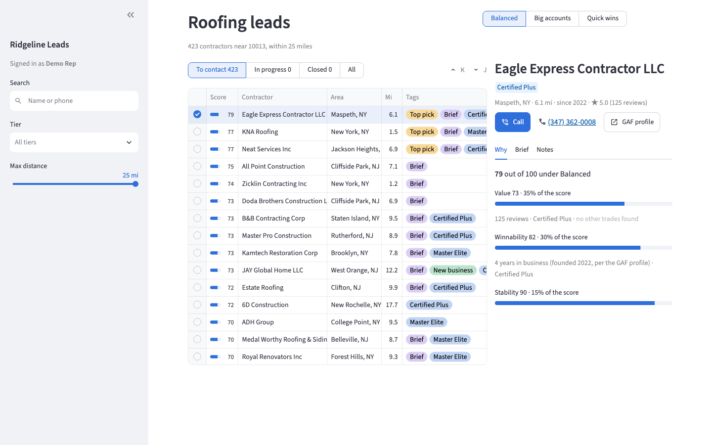
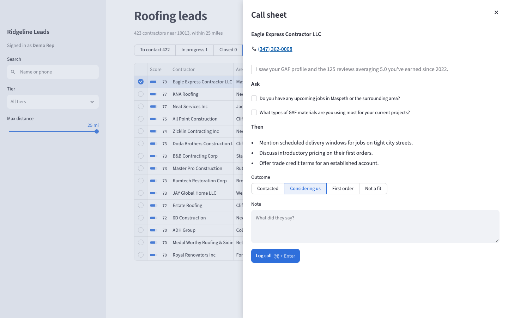

# Ridgeline Leads

Ridgeline Leads is a sales-intelligence tool for a roofing distributor's branch: a batch pipeline finds the GAF-certified roofing contractors near the branch, enriches them from their GAF profiles and websites, scores them with plain rules, and has an AI write a short touch plan for the top leads. A Streamlit app gives reps the ranked lead list, the reasons behind each score, each lead's brief, and a call sheet to log the call.





## Run it

Needs Python 3.11 or newer. If `python3 --version` is older, use `python3.11` (or newer) in the venv command. No API keys are needed: the app runs on the seed database, the pipeline's output for the branch at ZIP 10013.

```bash
git clone https://github.com/RayanHossain/instaLILY-takehome.git
cd instaLILY-takehome
python3 -m venv .venv
source .venv/bin/activate
pip install -r requirements.txt
cp .env.example .env
mkdir -p data
cp seed/leads.db data/leads.db
alembic upgrade head
streamlit run streamlit_app.py
```

The app opens at http://localhost:8501. Run every command from the repo root: `.env` and `data/leads.db` are found relative to the current folder.

## Tests

```bash
pytest
```

All offline: each test gets a fresh temporary database, and the sources are tested against saved responses in `tests/fixtures/`, never the network or `data/leads.db`.

`python -m app.evals extract` scores the extract stage's answers, field by field, against hand-checked facts in `evals/extract_gold.yaml`. On the seed, every answer comes from the AI cache, so it needs no key.

## The pipeline

```bash
python -m app.pipeline run --stages discover,fetch,parse,check_websites,capture_websites,extract,score,brief
```

Stages run in the order given, and any subset works. Each is safe to rerun and skips finished work.

| Stage | What it does | Key |
|---|---|---|
| `discover` | Searches GAF's contractor locator around the territory and upserts every contractor. | `COVEO_API_KEY` |
| `fetch` | Saves each contractor's GAF profile page. | |
| `parse` | Reads the saved profile pages into contractor fields: address, website, About text, years in business. | |
| `check_websites` | Sends one request to each contractor's website and records the status or error. | |
| `capture_websites` | Saves the homepage of every website that answered. | |
| `extract` | The AI pulls facts (services, other trades, building types, service areas, owners, founding year) from the About text and homepage, each with the exact quote it rests on. | `GEMINI_API_KEY` |
| `score` | Rules only: value, winnability, stability, and distance scores (0-100), flags, and the reasons behind them. | |
| `brief` | The AI writes a touch plan for each preset's top leads from their facts and matched selling points. | `GEMINI_API_KEY` |

Put keys in `.env`. Every raw response and AI answer is saved before it's parsed. `python -m app.pipeline stats` prints the latest AI stage run's numbers.

The seed keeps the pipeline's output but not its raw pages: no GAF search or profile pages, and only the 10 homepages the eval needs. On the seed, run `score` and the eval; for anything else, start again from `discover` with both keys. Don't run `extract` on the seed: it would rebuild facts without the homepages they came from.

## Customize it

| What you change | Where | Then rerun | Why |
|---|---|---|---|
| Preset weights, or a new preset | `presets` in `config/scoring.yaml` (each must add up to 100) | Nothing for the ranking: click Rerun in the app. Then `brief` for leads new to a preset's top N. | A preset's total is worked out from the stored component scores when leads are read, and never stored. |
| Scoring points, buckets, and flag thresholds | `value`, `winnability`, `stability`, and `flags` in `config/scoring.yaml`; bump `rules_version` | `score`, then `brief` | Scores are stored, and each says which `rules_version` made it. A brief's input includes its lead's matched selling points, and credit terms depend on stability and flags. |
| Territory | `territory` in `config/distributor.yaml`: `zip`, `lat`, `lng` (the branch's coordinates; nothing looks them up from the ZIP), `radius_miles` | Every stage, from `discover` | Discover searches around `lat`/`lng` within the radius. The distance score (100 at the branch, 0 at the radius) and the app's distance filter use the same center and radius. |
| Selling points | `selling_points` in `config/distributor.yaml`; which lead gets which is `match_selling_points()` in `app/briefs.py` | `brief` | A matched point's description is part of the brief's input, so a changed description rewrites those briefs. A new point needs a rule in `match_selling_points()`, and every id a rule names must stay in the file. |
| How many top leads get briefs | `TOP_LEADS_PER_PRESET` in `.env` (default 10) | `brief`; the app's Top pick tag follows on Rerun | The brief stage writes briefs for each preset's top N, and the app tags the same N. |
| The model | `GEMINI_MODEL` in `.env` (default `gemma-4-31b-it`) | `extract`, `score`, `brief`; then `python -m app.evals extract` to compare | The model is part of every AI cache key and every brief's record, so a new model answers everything again. Score reads the facts extract writes. |
| A prompt | Add `app/ai/prompts/<name>_v<N+1>.txt` and point `PROMPT` at it in `app/pipeline/extract.py` or `app/pipeline/brief.py` | That stage (and `score` and `brief` after `extract`) | The cache key holds the prompt's name, not its text, so editing a prompt file in place keeps reusing the cached answers. |

## Project map

- `app/`: `settings.py` (reads `.env` and the distributor config), `scoring.py` (the scoring rules), and `briefs.py` (the brief model, the selling-point rules, and the brief checks)
- `app/ai/`: `generate()`, the one way to call the AI (cache, validation, pacing, backoff), and the versioned prompts
- `app/db/`: the engine, the ORM models, and the upsert helper
- `app/evals/`: the extraction eval
- `app/pipeline/`: the command line and one module per stage
- `app/services/`: leads, notes, and reps; each function takes a session and returns Pydantic models
- `app/sources/`: one adapter per data source: GAF's search, GAF profile pages, and contractor websites
- `app/ui/`: the Streamlit page (`main.py`) and its only route to the services (`data.py`)
- `config/`: `distributor.yaml` (territory and selling points) and `scoring.yaml` (every scoring number and the presets)
- `docs/`: the screenshots above
- `evals/`: `extract_gold.yaml`, the hand-checked facts the eval scores against
- `migrations/`: Alembic migrations; the first one also adds the demo rep
- `seed/`: `leads.db`, the seed database
- `tests/`: the pytest suite, with saved responses in `tests/fixtures/`

[DESIGN.md](DESIGN.md) explains how it's designed and why. [AGENTS.md](AGENTS.md) holds the rules, layout, and commands for anyone changing the code, person or agent.
